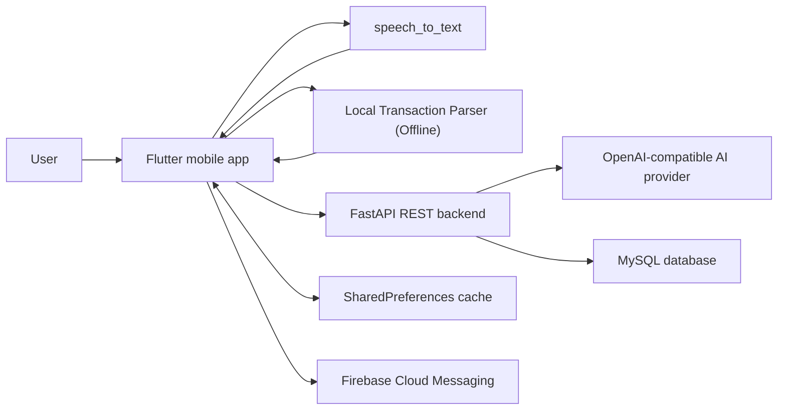
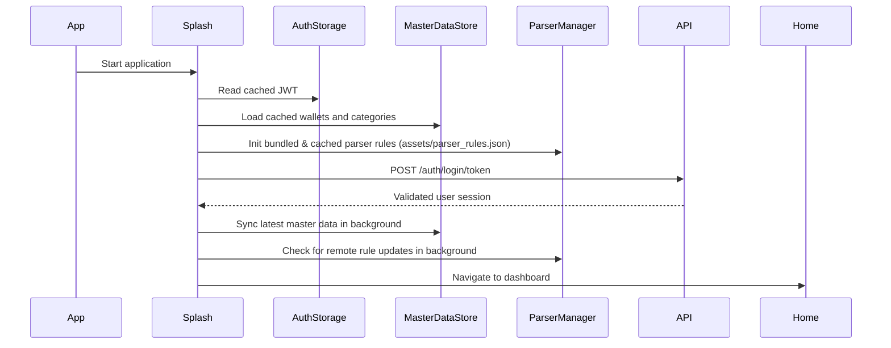
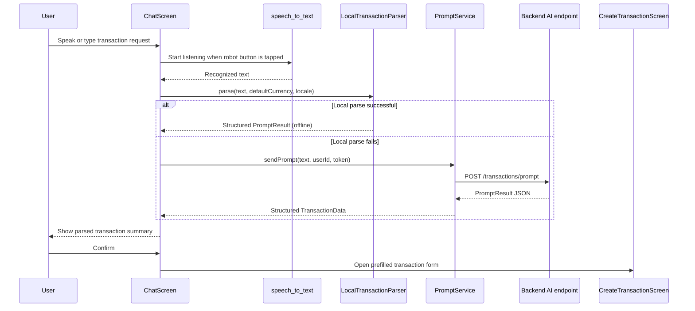
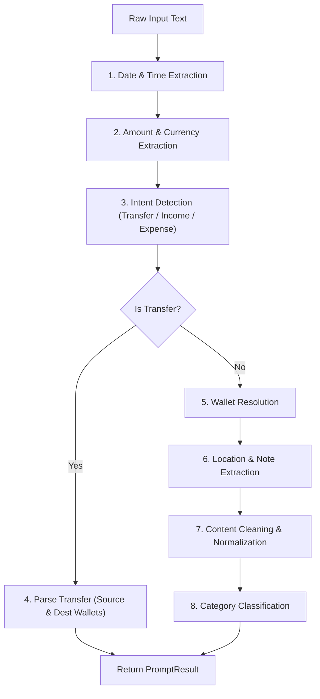
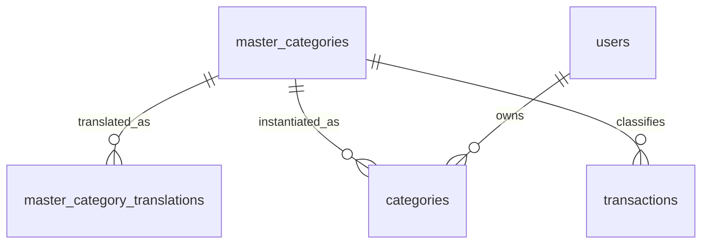

# FinA Technical Overview

## 1. Purpose

FinA is a Flutter personal-finance application focused on low-friction transaction
entry. Users can create transactions manually or describe them in a chat
interface. The chat flow can convert speech to text on the device and parse transactions either via an online backend AI parser or instantly offline using a robust client-side **Local Transaction Parser**.

This document describes the architecture, mobile application structure, backend REST API, database schema, local caching, and a detailed technical breakdown of the Local Parser along with a guide on adding support for new languages (such as Chinese).

## 2. System Architecture



The mobile application is a REST client with integrated local intelligence. The FastAPI backend owns MySQL persistence, authentication, master-data serialization, wallet balance recalculation, and AI parsing. The app caches session data, settings, and synced master data locally with `SharedPreferences`.

## 3. Mobile Application

### Technology stack

| Concern | Implementation |
| --- | --- |
| Application framework | Flutter, Dart `^3.5.4` |
| UI | Material 3, Google Fonts |
| State and locale propagation | `provider`, `ChangeNotifier` |
| Localization | ARB resources, `flutter_localizations`, `intl` |
| Speech recognition | `speech_to_text` |
| HTTP communication | `http` |
| Local key-value cache | `shared_preferences` |
| Push notifications | Firebase Messaging |
| Charts | `fl_chart` |
| Bill image selection and resizing | `image_picker`, `image` |

### Main modules

| Path | Responsibility |
| --- | --- |
| `lib/main.dart` | App bootstrap, theme, localization delegates, routes, ParserRulesManager init |
| `lib/session.dart` | In-memory authenticated session |
| `lib/screens/chat_screen.dart` | Conversational entry, speech-to-text, local/AI result confirmation |
| `lib/screens/create_transaction_screen.dart` | Manual entry and prefilled transaction form |
| `lib/screens/edit_transaction_screen.dart` | Transaction update and delete flow |
| `lib/screens/home_screen.dart` | Dashboard, balances, recent transactions, quick actions |
| `lib/screens/history_screen.dart` | Filtered transaction history |
| `lib/screens/wallet_list_screen.dart` | Wallet management |
| `lib/services/prompt_service.dart` | Production AI parser API call & local fallback integration |
| `lib/services/local_transaction_parser.dart` | Offline rule-based natural language transaction parser |
| `lib/services/parser_rules.dart` | Parser rule pack schema, models, regex builder, and self-tests |
| `lib/services/parser_rules_manager.dart` | Bundled vs cached rule management and server sync with SHA-256 validation |
| `lib/services/transaction_service.dart` | Transaction CRUD REST client |
| `lib/services/master_data_service.dart` | User initialization and master-data sync |
| `lib/services/master_data_store.dart` | In-memory master-data store and local cache |
| `lib/services/auth_service.dart` | Login, token restoration, logout, FCM token handling |
| `lib/services/settings_service.dart` | Locale, currency, and date-format preferences |

### App startup and session restoration



If the user has not completed onboarding, the splash screen routes to the
onboarding flow before opening the dashboard.

## 4. Conversational Transaction Flow & Local Parser

FinA supports both offline local parsing and online backend AI parsing for chat requests.



## 5. Detailed Technical Breakdown: Local Transaction Parser

The **Local Transaction Parser** (`lib/services/local_transaction_parser.dart`) provides instant offline natural language transaction recognition. It operates without network latency, making it ideal for voice input in chat.

### 5.1 Architecture & Rule Packs (`parser_rules.json`)
- **Separation of Logic and Data**: The parsing engine code (`LocalTransactionParser`) is fixed, while all linguistic data (keywords, currency symbols, unit multipliers, intent phrases, category aliases) resides in an external JSON rule pack (`assets/parser_rules.json`).
- **Dynamic Server Updates (`ParserRulesManager`)**:
  - The app bundles a default rule pack (`assets/parser_rules.json`).
  - At startup (`main.dart`), `ParserRulesManager` initializes the bundled rules and checks local storage for a newer cached version.
  - It fetches a remote `manifest.json` from the server containing `version`, `url`, `sha256`, and `minEngine`.
  - Security and Compatibility Checks before applying updates:
    1. **Version check**: New version must be strictly greater than current.
    2. **Engine compatibility**: `minEngine` must be `<= kParserEngineVersion`.
    3. **Checksum verification**: SHA-256 hash of downloaded JSON must match `sha256` in the manifest.
    4. **Self-test validation**: Runs built-in test cases (`LocalTransactionParser.runSelfTests(pack)`) against the candidate rule pack. If any test case fails, the update is rejected.

### 5.2 The 8-Step Parsing Pipeline

When `LocalTransactionParser.parse(input)` is invoked, it executes an 8-step deterministic pipeline:



1. **Date & Time Extraction (`_extractDateTime`)**:
   - Parses explicit dates (e.g., `ngày 15/05`, `15/5/2026`).
   - Parses relative day expressions (e.g., `hôm qua`, `hôm nay`, `hôm kia`, `yesterday`, `today`) mapped via `relativeDays` to day offsets.
   - Parses N days ago expressions (e.g., `2 ngày trước`, `3 days ago`) using `nDaysAgoRegex`.
   - Defaults to `DateTime.now()` if no date is mentioned.

2. **Amount & Currency Extraction (`_extractAmount`)**:
   - **Pattern 1 (Prefix)**: Matches currency symbols followed by numbers (e.g., `$15`, `₫50,000`, `€25`, `S$ 8.50`).
   - **Pattern 2 (Suffix)**: Matches numbers followed by unit multipliers or currency codes (e.g., `35k`, `50 nghìn`, `1.5tr`, `2 triệu`, `2 củ`, `3 lít`, `12 SGD`).
   - **Pattern 3 (Standalone)**: Matches numbers without units (e.g., `Kopi 1.80`, `35000`), defaulting to `defaultCurrency`.

3. **Intent Detection (`_isTransferIntent`, `_isIncomeIntent`)**:
   - Normalizes text (removes diacritics and converts to lowercase).
   - Checks against `transferIntentKeywords` and `incomeIntentKeywords` to determine transaction type (`AppConstants.TRANSFER`, `AppConstants.INCOME`, or `AppConstants.EXPENSE`).

4. **Transfer Flow Processing (`_parseTransfer`)**:
   - Strips transfer verbs (`chuyển khoản`, `rút tiền`, `transfer`).
   - Parses source and destination using `fromToPattern` (e.g., `từ VCB sang MoMo`, `from bank to cash`) or withdrawal hints (`rút từ thẻ tín dụng`).

5. **Wallet Resolution (`_extractWallet`)**:
   - Detects explicit wallet prepositions (`bằng ví VCB`, `qua momo`, `using cash`, `via bank`).
   - Performs direct wallet name lookup against user wallets in `MasterDataStore().wallets` or aliases (`cashTerms`, `bankHintTerms`).

6. **Location / Note Extraction (`_extractLocation`)**:
   - Matches location prepositions (`ở Highlands`, `tại Circle K`, `at Starbucks`).
   - Guards against category false positives (e.g., in `"quán cafe 35k"`, `"cafe"` is recognized as a category rather than a location).

7. **Content Cleaning (`_cleanContent`)**:
   - Strips leading action verbs (`mua`, `ăn`, `paid`, `bought`, etc.) and filler words (`tiền`, `cho mình`, `hết`).
   - Protects critical compound nouns from being stripped (e.g., `tiền nhà`, `tiền điện`, `tiền nước`, `tiền mạng` via `keepTienPhrases`).
   - Capitalizes the final transaction content string.

8. **Category Classification (`_resolveMasterCategoryId`)**:
   - For **Income**: Matches normalized content and full sentence against `incomeCategories` keywords.
   - For **Expense**: Matches against `expenseGeneralCategories` (e.g., Food & Drink, Transport) first, then `expenseSpecificCategories` (e.g., Rent, Electricity, Internet, Fuel).
   - Falls back to default category IDs (`defaultIncomeCategory` = 35, `defaultExpenseCategory` = 34).

---

## 6. Guide: Adding Support for a New Language (e.g., Chinese / Tiếng Trung - `zh`)

To extend the Local Transaction Parser to support Chinese language inputs (e.g., `"吃面 35元"`, `"发工资 5000元"`, `"昨天 支付宝转账 200元"`), follow these 4 steps:

### Step 1: Update `assets/parser_rules.json` with Chinese Linguistic Rules
Open `assets/parser_rules.json` and add Chinese entries across the rule sections:

1. **`relativeDays`**: Add relative time expressions and their day offsets.
   ```json
   "昨天": -1,
   "昨天晚上": -1,
   "今天": 0,
   "今天早上": 0,
   "今天下午": 0,
   "前天": -2,
   "yesterday": -1,
   "today": 0
   ```
2. **`nDaysAgoUnits`**: Add Chinese suffixes for "days ago".
   ```json
   "天前",
   "days ago"
   ```
3. **`currencySymbols`**: Add Chinese currency symbols.
   ```json
   "¥": "CNY",
   "元": "CNY",
   "块": "CNY"
   ```
4. **`amountUnits`**: Add Chinese numeric multipliers and currency units.
   ```json
   { "u": "元", "currency": "CNY" },
   { "u": "块", "currency": "CNY" },
   { "u": "千", "mult": 1000 },
   { "u": "万", "mult": 10000 }
   ```
5. **`transferIntentKeywords` & `incomeIntentKeywords`**: Add Chinese intent keywords.
   - `transferIntentKeywords`: `["转账", "汇款", "取现", "转", "transfer"]`
   - `incomeIntentKeywords`: `["工资", "收到", "奖金", "收入", "兼职", "salary", "bonus"]`
6. **`transferVerbs`, `transferFromWords`, `transferToWords`, `withdrawHints`**:
   - `transferVerbs`: `["转账", "汇款", "取现", "transfer"]`
   - `transferFromWords`: `["从", "自", "from"]`
   - `transferToWords`: `["到", "至", "给", "to"]`
   - `withdrawHints`: `["取现", "withdraw"]`
7. **`walletAliases`**:
   - `cash`: `["现金", "cash"]`
   - `bankHint`: `["银行卡", "网银", "bank"]`
   - `bankWallet`: `["银行", "bank"]`
8. **`locationPrepositions`**:
   ```json
   "在", "于", "at", "in"
   ```
9. **`leadingVerbs`**: Add Chinese action verbs.
   ```json
   "买", "吃", "喝", "付", "花", "买单", "收到", "赚", "bought", "pay"
   ```
10. **`fillerWords`**: Add Chinese filler words.
    ```json
    "钱", "的", "了", "给", "for"
    ```
11. **`incomeCategories` & `expenseGeneralCategories` / `expenseSpecificCategories`**: Add Chinese keywords to existing master categories.
    - Category `1` (Salary): Add `"工资"`, `"薪水"`
    - Category `2` (Bonus): Add `"奖金"`, `"年终奖"`
    - Category `9` (Food & Drink): Add `"饭"`, `"面"`, `"咖啡"`, `"奶茶"`, `"餐厅"`, `"吃饭"`
    - Category `10` (Transport): Add `"出租车"`, `"地铁"`, `"公交车"`, `"滴滴"`
    - Category `28` (Rent): Add `"房租"`
    - Category `29` (Electricity): Add `"电费"`
    - Category `30` (Water): Add `"水费"`

### Step 2: Handle Chinese Tokenization & Substring Matching
Unlike English or Vietnamese which use space delimiters (`\b` word boundaries), Chinese sentences do not contain spaces between characters (e.g., `"吃面35元"` or `"吃面 35元"`).

1. **Update `_hasWordOrPhrase` in `lib/services/local_transaction_parser.dart`**:
   - For non-space languages or Chinese keywords without spaces, `\b` regex word boundaries fail because Chinese characters do not have whitespace boundaries.
   - Adjust `_hasWordOrPhrase` to check substring containment (`text.contains(keyword)`) for Chinese/non-space character keywords, or ensure character-level matching:
   ```dart
   static bool _hasWordOrPhrase(String text, String keyword) {
     if (keyword.contains(' ') || _isChinese(keyword)) {
       return text.contains(keyword);
     }
     return RegExp(r'(?:^|\s+)' + RegExp.escape(keyword) + r'(?=$|\s+)')
         .hasMatch(text);
   }

   static bool _isChinese(String text) {
     return RegExp(r'[\u4e00-\u9fa5]').hasMatch(text);
   }
   ```

### Step 3: Localization Support (`_categoryLocale`)
Ensure `_categoryLocale(locale)` in `LocalTransactionParser` handles Chinese locales (`zh`, `zh_CN`, `zh_TW`):
```dart
  static String _categoryLocale(String locale) {
    final normalized = locale.toLowerCase();
    if (normalized.startsWith('en')) return 'en';
    if (normalized.startsWith('zh')) return 'zh';
    return 'vi';
  }
```
And provide fallback default contents in `_getDefaultContent`:
```dart
  static String _getDefaultContent(int type, int categoryId, String locale) {
    if (locale == 'zh') {
      if (type == AppConstants.INCOME) return '收入';
      if (type == AppConstants.TRANSFER) return '转账';
      return '支出';
    }
    if (type == AppConstants.INCOME) {
      return locale == 'vi' ? 'Thu nhập' : 'Income';
    }
    return locale == 'vi' ? 'Chi tiêu' : 'Expense';
  }
```

### Step 4: Add Test Cases in `parser_rules.json` and Test Suite
Add Chinese test cases in the `tests` section of `assets/parser_rules.json`:
```json
{
  "input": "吃面 35元",
  "type": "expense",
  "amount": 35,
  "currency": "CNY",
  "category": 9
},
{
  "input": "收到工资 8000元",
  "type": "income",
  "amount": 8000,
  "currency": "CNY",
  "category": 1
}
```
Run `flutter test` to verify that all Chinese test cases pass successfully.

---

## 7. Localization and Master Categories

FinA supports Vietnamese (`vi`) and English (`en`) in the current ARB resources.
The selected locale is stored locally and sent to the backend during master-data
sync and AI prompt parsing.

The database separates canonical categories from localized names. The active
backend master-data sync returns canonical categories directly; user-specific
`categories` rows remain in the SQL schema and repository layer but are not used
by the current sync response.



### Category tables

| Table | Purpose |
| --- | --- |
| `master_categories` | Canonical category definition: icon, type, sort order |
| `master_category_translations` | Localized category name, unique by `(category_id, locale)` |
| `categories` | Legacy or future user-specific category records, optionally linked to a canonical category through `master_id` |

The AI parser should return the best matching `master_category_id` for the
active `language_code`. In the current backend, `transactions.category_id` is
treated as this canonical master-category identifier and transaction queries join
it directly to `master_categories.id`.

Examples:

| Canonical ID | Type | Vietnamese | English |
| --- | --- | --- | --- |
| `1` | Income | Lương | Salary |
| `9` | Expense | Ăn uống | Food & Drink |
| `10` | Expense | Đi lại | Transport |
| `28` | Expense | Tiền nhà | Rent |
| `34` | Expense | Khác | Other |
| `35` | Income | Khác | Other |

## 8. REST API Used by the Mobile App

The backend base URL is configured in `lib/app_constants.dart`.

| Method | Endpoint | Purpose |
| --- | --- | --- |
| `POST` | `/auth/login` | Password login |
| `POST` | `/auth/login/token` | Restore and validate JWT session |
| `POST` | `/auth/signup` | Register user |
| `POST` | `/users/initialize` | Initialize onboarding defaults |
| `GET` | `/master-data/sync` | Sync wallets and localized categories with optional client MD5 |
| `POST` | `/transactions/prompt` | Convert user text to structured transaction JSON |
| `POST` | `/transactions` | Create transaction |
| `GET` | `/transactions` | List and filter transactions |
| `GET` | `/transactions/{id}` | Fetch transaction details |
| `PUT` | `/transactions/{id}` | Update transaction |
| `DELETE` | `/transactions/{id}` | Delete transaction |
| `GET` | `/dashboard/summary` | Load dashboard summary |
| `POST` | `/bills/upload-temp` | Intended temporary bill-image upload endpoint |

Transaction list filters currently include pagination, type, wallet, category,
and date range.

### Backend implementation

The backend is a FastAPI application under `finaserver/`.

| Path | Responsibility |
| --- | --- |
| `app/comm.py` | FastAPI entrypoint, router registration, legacy endpoints |
| `app/ai_service.py` | AI prompt, provider call, JSON cleanup, normalization, dev fallback |
| `app/db/database.py` | Pooled MySQL access with commit and rollback handling |
| `app/middleware/auth.py` | JWT authentication dependency |
| `app/routers/auth.py` | Password auth, token validation, OAuth stubs, OTP flows |
| `app/routers/transaction.py` | Transaction CRUD and `/transactions/prompt` |
| `app/routers/user_routes.py` | Onboarding initialization and MD5-based master-data sync |
| `app/routers/wallet.py` | Wallet CRUD and cache invalidation |
| `app/routers/dashboard.py` | Dashboard summary and recent transactions |
| `app/services/common_service.py` | Stored-procedure wallet balance recalculation |

## 9. Database Overview

The provided `fina_db.sql` describes a MySQL schema.

### Core tables

| Table | Purpose |
| --- | --- |
| `users` | Account profile, auth provider, OTP, avatar, FCM token, status |
| `wallets` | User wallets, wallet type, currency, balance, credit metadata |
| `transactions` | Expense, income, and transfer records |
| `categories` | User-specific category rows retained in the schema |
| `master_categories` | Canonical category catalog |
| `master_category_translations` | Localized master-category names |
| `bill_images` | Bill image URLs attached to transactions |
| `user_master_data_hash` | Per-user MD5 used to optimize master-data sync |

### Planned or partially integrated tables

| Table | Purpose |
| --- | --- |
| `debt_tracking` | Amounts owed or lent |
| `pending_inputs` | Raw unprocessed conversational inputs |
| `recurring_templates` | Recurring transaction templates |
| `recurring_schedules` | Schedule state for recurring templates |

### Transaction schema

The `transactions` table is the center of the financial model.

| Column | Meaning |
| --- | --- |
| `userid` | Owner |
| `content` | Transaction description |
| `currency` | ISO-like currency code, default `VND` |
| `amount` | Source amount |
| `type` | `0=expense`, `1=income`, `2=transfer` |
| `date_time` | Effective transaction timestamp |
| `category_id` | Canonical `master_categories.id`, nullable for transfers |
| `wallet_id` | Source wallet |
| `to_wallet_id` | Destination wallet for transfers |
| `receive_amount` | Destination amount for transfers or cross-currency cases |
| `notes` | Free-form notes |
| `tags` | Comma-separated tags |
| `status` | Transaction status |

### Views

| View | Purpose |
| --- | --- |
| `v_transaction_summary` | Active transactions projected with month, quarter, and year fields |
| `v_user_balance` | Aggregated wallet balance per user and currency |

### Important indexes

| Table | Index |
| --- | --- |
| `transactions` | `(userid, date_time)`, `wallet_id`, `category_id` |
| `wallets` | `userid` |
| `categories` | `userid` |
| `users` | Unique `email` |
| `master_category_translations` | Unique `(category_id, locale)` |

## 10. Local Cache and Sync

The app uses `SharedPreferences` for:

| Data | Keys |
| --- | --- |
| Session | `jwt_token`, `user_data` |
| Settings | `locale`, `currency`, `date_time_format`, `date_format` |
| Master data | `master_data_json`, `master_data_md5` |
| Recent tags | `recent_tags` |

Master-data sync uses `client_md5`. If the backend reports that data has not
changed, the app keeps the cached wallets and localized categories. This reduces
payload size and allows the home screen to render cached data before the
background refresh completes.

`GET /master-data/sync` builds its response from:

- Wallets owned by the authenticated user.
- Canonical `master_categories`.
- `master_category_translations` for the requested locale, with English
  fallback.

`POST /users/initialize` currently creates the default Cash wallet and updates
the user status to `9`. It no longer copies master categories into per-user
category rows.

## 11. Known Gaps and Follow-Up Work

- `BillUploadService` still uses the placeholder base URL
  `https://your-api.com`; the FastAPI backend does not currently expose
  `/bills/upload-temp`.
- The Flutter dependency list includes `sqflite`, but the current app code uses
  `SharedPreferences` for cache and REST endpoints for persistent transaction
  storage.
- The AI parser contract should explicitly document transfer responses if chat
  entry will support `type = 2`.
- The schema still contains user-specific `categories` rows while the active
  backend treats `transactions.category_id` as `master_categories.id`. Choose
  one model and document it as the canonical contract before adding custom
  categories.
- `_parse_and_validate()` should validate `master_category_id` against the
  allowed income and expense ranges before returning AI output.
- The no-key heuristic mock parser returns legacy category names instead of
  `master_category_id`, so development fallback results can diverge from
  provider-backed results.
- Foreign-key constraints are not present in the supplied SQL dump. They should
  be reviewed before production migration.
- Database dumps can contain account data and password hashes. Keep
  `fina_db.sql` out of public repositories and replace it with sanitized
  migrations or fixtures for sharing.
