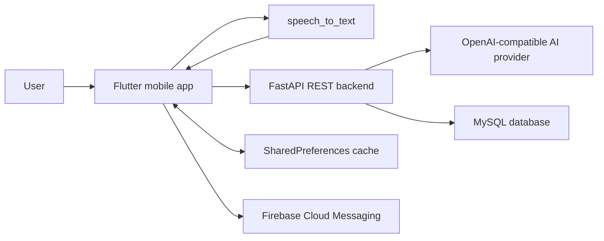
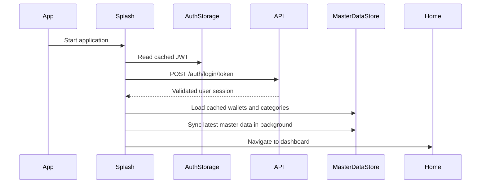
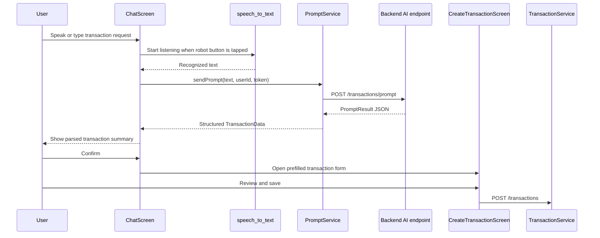
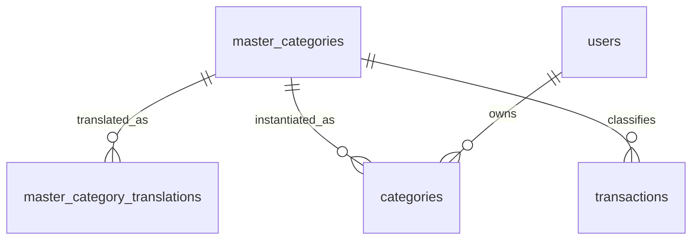

# FinA Technical Overview

## 1. Purpose

FinA is a Flutter personal-finance application focused on low-friction transaction
entry. Users can create transactions manually or describe them in a chat
interface. The chat flow converts speech to text on the device, sends the text to
the backend AI parser, receives structured JSON, and opens the standard
transaction form for user review before saving.

This document describes the current implementation on the `main` branch. A
rule-based local parser exists only on the experimental branch
`local-parser-experiment` and is not part of the production flow.

## 2. System Architecture



The mobile application is a REST client. The FastAPI backend owns MySQL
persistence, authentication, master-data serialization, wallet balance
recalculation, and AI parsing. The app caches session data, settings, and synced
master data locally with `SharedPreferences`.

## 3. Mobile Application

### Technology stack

| Concern | Implementation |
| --- | --- |
| Application framework | Flutter, Dart `^3.5.4` |
| UI | Material 3, Google Fonts |
| State and locale propagation | `provider`, `ChangeNotifier` |
| Localization | ARB resources, `flutter_localizations`, `intl` |
| Speech recognition | `speech_to_text` |
| HTTP communication | `http` |
| Local key-value cache | `shared_preferences` |
| Push notifications | Firebase Messaging |
| Charts | `fl_chart` |
| Bill image selection and resizing | `image_picker`, `image` |

### Main modules

| Path | Responsibility |
| --- | --- |
| `lib/main.dart` | App bootstrap, theme, localization delegates, routes |
| `lib/session.dart` | In-memory authenticated session |
| `lib/screens/chat_screen.dart` | Conversational entry, speech-to-text, AI result confirmation |
| `lib/screens/create_transaction_screen.dart` | Manual entry and AI-prefilled transaction form |
| `lib/screens/edit_transaction_screen.dart` | Transaction update and delete flow |
| `lib/screens/home_screen.dart` | Dashboard, balances, recent transactions, quick actions |
| `lib/screens/history_screen.dart` | Filtered transaction history |
| `lib/screens/wallet_list_screen.dart` | Wallet management |
| `lib/services/prompt_service.dart` | Production AI parser API call |
| `lib/services/transaction_service.dart` | Transaction CRUD REST client |
| `lib/services/master_data_service.dart` | User initialization and master-data sync |
| `lib/services/master_data_store.dart` | In-memory master-data store and local cache |
| `lib/services/auth_service.dart` | Login, token restoration, logout, FCM token handling |
| `lib/services/settings_service.dart` | Locale, currency, and date-format preferences |

### App startup and session restoration



If the user has not completed onboarding, the splash screen routes to the
onboarding flow before opening the dashboard.

## 4. Conversational Transaction Flow

The production flow uses the backend AI parser.



The backend implementation lives in `finaserver/app/ai_service.py`. It sends a
system prompt and user context to an OpenAI-compatible `/chat/completions`
endpoint using `httpx`. Provider URL, API key, model, and timeout come from
environment variables:

| Variable | Purpose |
| --- | --- |
| `AI_API_KEY` | Provider credential |
| `AI_BASE_URL` | OpenAI-compatible provider base URL |
| `AI_MODEL` | Provider model identifier |
| `AI_TIMEOUT_SECONDS` | Request timeout, default `25` seconds |

If `AI_API_KEY` is absent, the backend currently falls back to a deterministic
heuristic mock parser for development.

### Prompt request

`POST /transactions/prompt`

```json
{
  "text": "Mua cafe 35k tại T1",
  "user_id": 123,
  "currency": "VND",
  "language_code": "vi"
}
```

### Prompt response model

The Flutter client expects a response compatible with:

```json
{
  "request_id": "request-id",
  "user_prompt": "Mua cafe 35k tại T1",
  "data": {
    "type": "expense",
    "amount": 35000,
    "currency": "VND",
    "content": "Cafe tại T1",
    "date_time": "2026-05-30T10:00:00Z",
    "master_category_id": 9,
    "wallet": null,
    "notes": "T1"
  }
}
```

`TransactionData.fromJson()` converts `type` to an integer:

| JSON value | App value | Meaning |
| --- | --- | --- |
| `expense` | `0` | Expense |
| `income` | `1` | Income |

The database additionally supports transfer transactions with `type = 2`.

## 5. Localization and Master Categories

FinA supports Vietnamese (`vi`) and English (`en`) in the current ARB resources.
The selected locale is stored locally and sent to the backend during master-data
sync and AI prompt parsing.

The database separates canonical categories from localized names. The active
backend master-data sync returns canonical categories directly; user-specific
`categories` rows remain in the SQL schema and repository layer but are not used
by the current sync response.



### Category tables

| Table | Purpose |
| --- | --- |
| `master_categories` | Canonical category definition: icon, type, sort order |
| `master_category_translations` | Localized category name, unique by `(category_id, locale)` |
| `categories` | Legacy or future user-specific category records, optionally linked to a canonical category through `master_id` |

The AI parser should return the best matching `master_category_id` for the
active `language_code`. In the current backend, `transactions.category_id` is
treated as this canonical master-category identifier and transaction queries join
it directly to `master_categories.id`.

Examples:

| Canonical ID | Type | Vietnamese | English |
| --- | --- | --- | --- |
| `1` | Income | Lương | Salary |
| `9` | Expense | Ăn uống | Food & Drink |
| `10` | Expense | Đi lại | Transport |
| `28` | Expense | Tiền nhà | Rent |
| `34` | Expense | Khác | Other |
| `35` | Income | Khác | Other |

## 6. REST API Used by the Mobile App

The backend base URL is configured in `lib/app_constants.dart`.

| Method | Endpoint | Purpose |
| --- | --- | --- |
| `POST` | `/auth/login` | Password login |
| `POST` | `/auth/login/token` | Restore and validate JWT session |
| `POST` | `/auth/signup` | Register user |
| `POST` | `/users/initialize` | Initialize onboarding defaults |
| `GET` | `/master-data/sync` | Sync wallets and localized categories with optional client MD5 |
| `POST` | `/transactions/prompt` | Convert user text to structured transaction JSON |
| `POST` | `/transactions` | Create transaction |
| `GET` | `/transactions` | List and filter transactions |
| `GET` | `/transactions/{id}` | Fetch transaction details |
| `PUT` | `/transactions/{id}` | Update transaction |
| `DELETE` | `/transactions/{id}` | Delete transaction |
| `GET` | `/dashboard/summary` | Load dashboard summary |
| `POST` | `/bills/upload-temp` | Intended temporary bill-image upload endpoint |

Transaction list filters currently include pagination, type, wallet, category,
and date range.

### Backend implementation

The backend is a FastAPI application under `finaserver/`.

| Path | Responsibility |
| --- | --- |
| `app/comm.py` | FastAPI entrypoint, router registration, legacy endpoints |
| `app/ai_service.py` | AI prompt, provider call, JSON cleanup, normalization, dev fallback |
| `app/db/database.py` | Pooled MySQL access with commit and rollback handling |
| `app/middleware/auth.py` | JWT authentication dependency |
| `app/routers/auth.py` | Password auth, token validation, OAuth stubs, OTP flows |
| `app/routers/transaction.py` | Transaction CRUD and `/transactions/prompt` |
| `app/routers/user_routes.py` | Onboarding initialization and MD5-based master-data sync |
| `app/routers/wallet.py` | Wallet CRUD and cache invalidation |
| `app/routers/dashboard.py` | Dashboard summary and recent transactions |
| `app/services/common_service.py` | Stored-procedure wallet balance recalculation |

## 7. Database Overview

The provided `fina_db.sql` describes a MySQL schema.

### Core tables

| Table | Purpose |
| --- | --- |
| `users` | Account profile, auth provider, OTP, avatar, FCM token, status |
| `wallets` | User wallets, wallet type, currency, balance, credit metadata |
| `transactions` | Expense, income, and transfer records |
| `categories` | User-specific category rows retained in the schema |
| `master_categories` | Canonical category catalog |
| `master_category_translations` | Localized master-category names |
| `bill_images` | Bill image URLs attached to transactions |
| `user_master_data_hash` | Per-user MD5 used to optimize master-data sync |

### Planned or partially integrated tables

| Table | Purpose |
| --- | --- |
| `debt_tracking` | Amounts owed or lent |
| `pending_inputs` | Raw unprocessed conversational inputs |
| `recurring_templates` | Recurring transaction templates |
| `recurring_schedules` | Schedule state for recurring templates |

### Transaction schema

The `transactions` table is the center of the financial model.

| Column | Meaning |
| --- | --- |
| `userid` | Owner |
| `content` | Transaction description |
| `currency` | ISO-like currency code, default `VND` |
| `amount` | Source amount |
| `type` | `0=expense`, `1=income`, `2=transfer` |
| `date_time` | Effective transaction timestamp |
| `category_id` | Canonical `master_categories.id`, nullable for transfers |
| `wallet_id` | Source wallet |
| `to_wallet_id` | Destination wallet for transfers |
| `receive_amount` | Destination amount for transfers or cross-currency cases |
| `notes` | Free-form notes |
| `tags` | Comma-separated tags |
| `status` | Transaction status |

### Views

| View | Purpose |
| --- | --- |
| `v_transaction_summary` | Active transactions projected with month, quarter, and year fields |
| `v_user_balance` | Aggregated wallet balance per user and currency |

### Important indexes

| Table | Index |
| --- | --- |
| `transactions` | `(userid, date_time)`, `wallet_id`, `category_id` |
| `wallets` | `userid` |
| `categories` | `userid` |
| `users` | Unique `email` |
| `master_category_translations` | Unique `(category_id, locale)` |

## 8. Local Cache and Sync

The app uses `SharedPreferences` for:

| Data | Keys |
| --- | --- |
| Session | `jwt_token`, `user_data` |
| Settings | `locale`, `currency`, `date_time_format`, `date_format` |
| Master data | `master_data_json`, `master_data_md5` |
| Recent tags | `recent_tags` |

Master-data sync uses `client_md5`. If the backend reports that data has not
changed, the app keeps the cached wallets and localized categories. This reduces
payload size and allows the home screen to render cached data before the
background refresh completes.

`GET /master-data/sync` builds its response from:

- Wallets owned by the authenticated user.
- Canonical `master_categories`.
- `master_category_translations` for the requested locale, with English
  fallback.

`POST /users/initialize` currently creates the default Cash wallet and updates
the user status to `9`. It no longer copies master categories into per-user
category rows.

## 9. Experimental Local Parser

The branch `local-parser-experiment` contains a rule-based parser prototype.
It parses constrained sentence patterns locally and attempts category
classification without calling the AI endpoint.

It is intentionally excluded from `main` because natural-language financial
inputs contain ambiguous merchant names, categories, currencies, and account
references. The production branch continues to call `/transactions/prompt`.

## 10. Known Gaps and Follow-Up Work

- `BillUploadService` still uses the placeholder base URL
  `https://your-api.com`; the FastAPI backend does not currently expose
  `/bills/upload-temp`.
- The Flutter dependency list includes `sqflite`, but the current app code uses
  `SharedPreferences` for cache and REST endpoints for persistent transaction
  storage.
- The AI parser contract should explicitly document transfer responses if chat
  entry will support `type = 2`.
- The schema still contains user-specific `categories` rows while the active
  backend treats `transactions.category_id` as `master_categories.id`. Choose
  one model and document it as the canonical contract before adding custom
  categories.
- `_parse_and_validate()` should validate `master_category_id` against the
  allowed income and expense ranges before returning AI output.
- The no-key heuristic mock parser returns legacy category names instead of
  `master_category_id`, so development fallback results can diverge from
  provider-backed results.
- Foreign-key constraints are not present in the supplied SQL dump. They should
  be reviewed before production migration.
- Database dumps can contain account data and password hashes. Keep
  `fina_db.sql` out of public repositories and replace it with sanitized
  migrations or fixtures for sharing.
